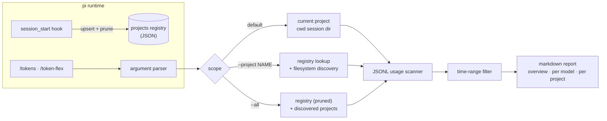
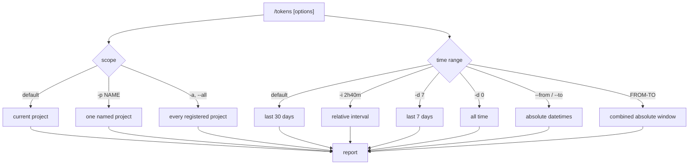

# token-flex

Token and cost statistics for [pi coding agent](https://pi.dev) sessions, with multi-project aggregation.


token-flex is a fork of [pi-token-stats](https://github.com/reaishijie/pi-token-stats) by
[@reaishijie](https://github.com/reaishijie), extended with English output, relative and
absolute time ranges, a self-maintaining project registry, per-project breakdowns,
reasoning-token accounting, and a `--setup` configuration report.

Distributed from GitLab only — there is no npm release.

## Features

- Adds the `/tokens` and `/token-flex` commands (both accept the same options).
- Scans pi session `.jsonl` files and aggregates input, output, cache read, cache write,
  reasoning, total tokens, and cost.
- Groups usage by `provider/model`, and by project for multi-project runs.
- Full time-range surface: relative intervals (`2h40m`, `1W`, `1M`), day counts,
  absolute datetimes (`--from` / `--to`), and combined `FROM-TO` windows.
- Multi-project scope: the current project, one named project (`--project`), or every
  project that has ever launched pi (`--all`).
- Self-maintaining project registry: each pi session registers its project and prunes
  stale entries automatically.
- `--setup` prints the resolved configuration and initializes the registry.
- Configuration through environment variables only; no state outside the pi agent
  directory unless you ask for it.

## Install

```bash
# From the GitLab repository
pi install git:gitlab.com/clankstank/pi-ext/token-stats

# Pin a tag or commit
pi install git:gitlab.com/clankstank/pi-ext/token-stats@v0.1.0

# Try it without installing (single invocation, local checkout)
pi -e /path/to/token-stats
```

Restart pi after installing so the extension loads.

## Usage

```
/tokens
/tokens 7
/tokens --interval 2h40m
/tokens --from 20260101 --to 20260131
/tokens 20260101-20260131
/tokens --all
/tokens -p acme-web
/tokens --setup
/token-flex --all
```

### Scope

| Option | Meaning |
| --- | --- |
| *(none)* | Current project (registry name for the working directory, or its basename) |
| `-p, --project NAME` | One registered or discoverable project |
| `-a, --all` | Every registered project, plus projects found through discovery |

### Time range

Default: last 30 days.

| Option | Meaning |
| --- | --- |
| `-i, --interval SPEC` | Relative window from now: `1m`, `2h40m`, `1D`, `1W`, `1M` (`m` minutes, `M` months, `d`/`D` days, `w`/`W` weeks) |
| `-d, --days N` | Last N days; a bare number `N` behaves the same |
| `-d 0`, `0`, `all` | All time |
| `--from YYYYMMDD[HHMM[SS]]` | Absolute range start (local time) |
| `--to YYYYMMDD[HHMM[SS]]` | Absolute range end (local time) |
| `FROM-TO` | Combined absolute window, e.g. `20260101-20260131` or `202601011200-202601311800` |
| `-h, --help` | Argument help overlay |
| `--setup` | Configuration report and registry initialization |

## How it works



Every pi session start upserts the current project into the registry and drops entries
whose probe path no longer exists, so renamed or removed projects do not accumulate.
When a project is unknown to the registry, discovery checks `PI_PROJECTS_ROOT` and the
standard pi sessions layout (`<agent dir>/sessions/--<cwd>--/`), deriving the project
name from the session header's `cwd`.

The registry is a small JSON file:

```json
{
  "version": 1,
  "updatedAt": 1790000000000,
  "projects": {
    "acme-web": {
      "name": "acme-web",
      "root": "/home/user/projects/acme-web",
      "sessionDir": "/home/user/.pi/agent/sessions/--home-user-projects-acme-web--",
      "lastSeen": 1790000000000
    }
  }
}
```

## Configuration

Every variable is optional. See [`.env.example`](./.env.example) for a copy-ready template.

| Variable | Default | Purpose |
| --- | --- | --- |
| `PI_PROJECT_REGISTRY` | `<agent dir>/registers/projects.json` | Registry file location |
| `PI_PROJECT_NAME` | basename of the working directory | Project name used by registration and the default scope |
| `PI_PROJECTS_ROOT` | *(unset)* | Discovery root: one subdirectory per project, each with a `sessions/` directory |
| `PI_CODING_AGENT_DIR` | `~/.pi/agent` | pi agent directory |
| `PI_CODING_AGENT_SESSION_DIR` | `<agent dir>/sessions` | Session storage override |

Run `/tokens --setup` first when something looks wrong; it reports the resolved paths,
the environment overrides in effect, and the discovered projects. It also initializes
the registry file when missing and registers the current project.

The report renders like this (synthetic data):

```
# token-flex — Setup

## Resolved configuration

| Setting | Value |
| --- | --- |
| Project name | `acme-web` |
| Session dir | `/home/user/.pi/agent/sessions` |
| Registry | `/home/user/.pi/agent/registers/projects.json` (created now) |
| Registry projects | 2 |
| Current project | registered now |

## Discovery

| Source | Location | Projects |
| --- | --- | ---: |
| `PI_PROJECTS_ROOT` | (unset) | 0 |
| Standard sessions root | `/home/user/.pi/agent/sessions` | 2 |
```

## What this fork adds

The comparison below is against upstream `pi-token-stats@0.1.1`.

| Capability | upstream pi-token-stats | token-flex |
| --- | --- | --- |
| Output language | Chinese | English |
| Commands | `/tokens`, `/token-stats` | `/tokens`, `/token-flex` |
| Argument surface | bare `N`, `--days N`, `-d N` | scope, interval, days, `--from`/`--to`, `FROM-TO`, `--setup`, `--help` |
| Time ranges | relative day counts | compound relative intervals plus absolute datetime windows |
| Scope | one session directory | current project, `--project NAME`, `--all` projects |
| Multi-project report | single implicit bucket | registry-backed, with a per-project breakdown table |
| Token fields | input, output, cache read, cache write | plus reasoning tokens |
| Number formatting | 万/亿 token compaction | standard `en-US` grouping throughout |
| Cost formatting | fixed 6 decimals | scale-aware (`$1.2345`, `$0.001234`) |
| Project registry | none | self-maintaining: upsert on session start, prune on removal |
| Discovery fallback | none | `PI_PROJECTS_ROOT` plus the standard pi sessions layout |
| Setup / diagnostics | none | `--setup` report and registry initialization |
| Completions | 3 fixed presets | presets plus registered project names |
| Testability | one default export | exported pure functions plus `npm run smoke` |
| Environment | agent and session dir overrides | plus `PI_PROJECT_REGISTRY`, `PI_PROJECT_NAME`, `PI_PROJECTS_ROOT` |

Scope and time options combine freely:



Example report for `/tokens --all` (synthetic data):

```
# Pi Token Usage

- Range: 2026-01-01 00:00 ~ 2026-01-31 00:00
- Scope: all projects (2)
- Session dirs: 2 project session dirs
- Files scanned: 2, sessions matched: 2
- Requests: 3
- Total tokens: 5,750
- Total cost: $0.032775

## Overview

| Input | Output | Cache Read | Cache Write | Reasoning | Total Tokens | Cost |
| ---: | ---: | ---: | ---: | ---: | ---: | ---: |
| 3,500 | 1,550 | 600 | 100 | 180 | 5,750 | $0.032775 |

## By Model

| Model | Requests | Input | Output | Cache Read | Cache Write | Reasoning | Total | Cost |
| --- | ---: | ---: | ---: | ---: | ---: | ---: | ---: | ---: |
| `anthropic/claude-sonnet-4.6` | 2 | 3,000 | 1,300 | 600 | 100 | 170 | 5,000 | $0.029775 |
| `openai/gpt-5.2` | 1 | 500 | 250 | 0 | 0 | 10 | 750 | $0.003000 |

## By Project

| Project | Requests | Total Tokens | Cost |
| --- | ---: | ---: | ---: |
| `acme-web` | 2 | 5,000 | $0.029775 |
| `acme-api` | 1 | 750 | $0.003000 |
```

## Development

```bash
npm install        # install dev dependencies (pi packages, TypeScript, Node types)
npm run typecheck  # tsc --noEmit
npm run smoke      # functional smoke test on synthetic sessions; prints both reports
```

`npm run smoke` builds temporary sessions, exercises parsing, range resolution,
aggregation, discovery, the registry and the setup report, and exits non-zero when a
check fails (37 checks at the time of writing).

## Credits

token-flex is a fork of [pi-token-stats](https://github.com/reaishijie/pi-token-stats) by
[@reaishijie](https://github.com/reaishijie). The upstream extension provides the original
single-directory scanner, the `/tokens` and `/token-stats` command wiring, and the TUI
report overlay; this fork keeps that command surface and extends it with the
multi-project registry, the wider time-range surface, reasoning accounting, and the
setup report.

- Upstream: <https://github.com/reaishijie/pi-token-stats> (MIT)
- Original work: Copyright (c) 2026 reaishijie
- Fork modifications: Copyright (c) 2026 AIFib

## License

[MIT](./LICENSE) — the upstream MIT notice is preserved and extended with the fork's
copyright line.
